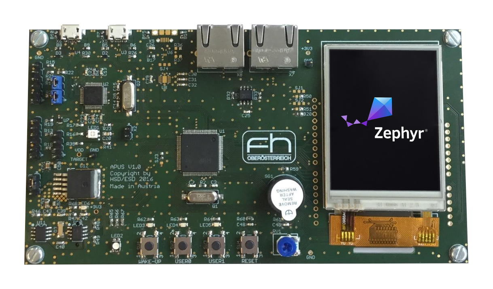
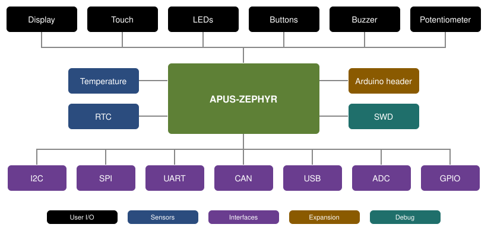

# apus-zephyr

Zephyr board support for the **APUS board**, a development board built around the
STM32F072VBT6 (Arm Cortex-M0, 128 KB flash / 16 KB RAM).

[](https://github.com/apus-org/apus-zephyr/actions/workflows/build.yml)



## Overview



## Quick start

Add apus-zephyr to the `west.yml` of an existing workspace:

```yaml
manifest:
  remotes:
    - name: apus-org
      url-base: https://github.com/apus-org
  projects:
    - name: apus-zephyr
      remote: apus-org
      revision: main
      path: modules/apus-zephyr
```

or create a new workspace from it:

```bash
west init -m https://github.com/apus-org/apus-zephyr apus-workspace
cd apus-workspace
west update
```

Build and flash a sample:

```bash
west build -b apus zephyr/samples/basic/blinky
west flash
```

`west flash` uses STM32CubeProgrammer; OpenOCD, J-Link and probe-rs are available with `-r`.

## Requirements

Zephyr `main` with the `hal_stm32` and `cmsis_6` modules, and the Zephyr SDK. See the
[Getting Started Guide](https://docs.zephyrproject.org/latest/develop/getting_started/index.html)
for the setup.

## Project layout

| Path | Contents |
|------|----------|
| [boards/](boards/) | board definition |
| [zephyr/](zephyr/) | module definition |
| [docs/](docs/) | documentation |
| [west.yml](west.yml) | west manifest |

## License

Licensed under the Apache License, Version 2.0 ([LICENSE](LICENSE) or
<http://www.apache.org/licenses/LICENSE-2.0>).
